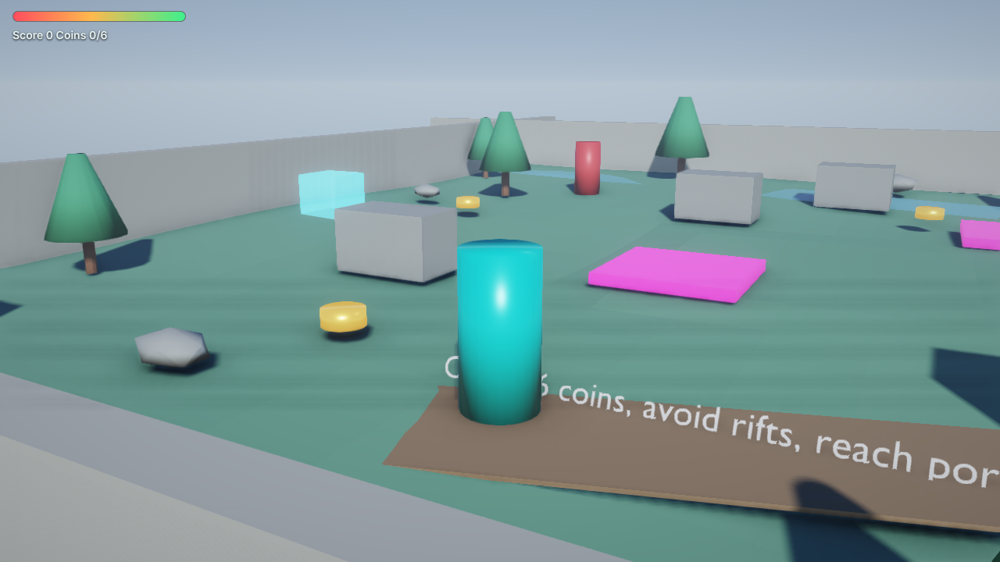
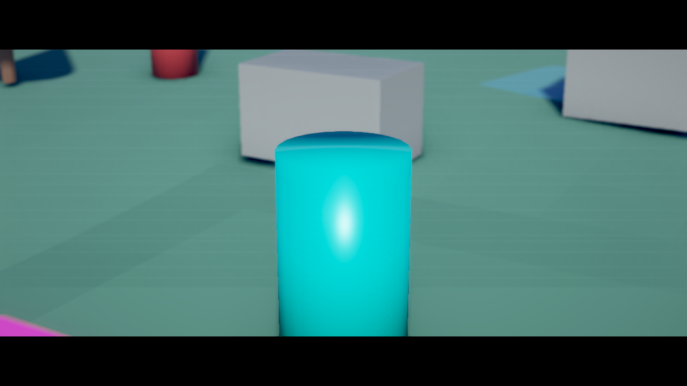

# BlendEngine — 3D Runtime (WebGL2)

[README](../README.md) · [Loyiha xaritasi](PROJECT_GUIDE.md) · [Baholash](EVALUATION.md) · [Changelog](../CHANGELOG.md)



*3D Starter World shabloni eksport qilingandan keyin brauzerda (ultra sifat, SwiftShader dasturiy renderida olingan).*

## Bu nima?

BlendEngine endi har bir eksportga **mustaqil 3D o'yin playerini** (`web_player/`) qo'shadi. U Blender'siz ishlaydi:
Chrome, Edge, Firefox, Safari, Android WebView va iOS WKWebView'da. Runtime bitta JavaScript fayl
(`blendengine_runtime.js`, ~130 KB), hech qanday tashqi kutubxona yoki server talab qilinmaydi —
`index.html` ni to'g'ridan-to'g'ri diskdan ochish kifoya.

| Qism | Fayl |
|---|---|
| Sahna eksporti (mesh, material, tekstura, yorug'lik, kamera, gameplay) | [`scripts/addons_core/blendengine/scene_export.py`](../scripts/addons_core/blendengine/scene_export.py) |
| Runtime (render, fizika, AI, gameplay, kiritish) | [`scripts/addons_core/blendengine/runtime_web/blendengine_runtime.js`](../scripts/addons_core/blendengine/runtime_web/blendengine_runtime.js) |
| Player sahifasi (HUD, menyu, touch boshqaruv) | [`scripts/addons_core/blendengine/runtime_web/index.html`](../scripts/addons_core/blendengine/runtime_web/index.html) |
| Paketlash (Web, Android, iOS, Desktop) | [`scripts/addons_core/blendengine/export_system.py`](../scripts/addons_core/blendengine/export_system.py) |

## Imkoniyatlar

**Render (realistik, lekin yengil)**
- Fizikaga asoslangan shading (GGX / Smith / Schlick) — Principled BSDF'dan base color, metallic, roughness, emission, alpha, normal map va teksturalar.
- Ikki kaskadli quyosh soyalari (yaqin kaskad har kadr, uzoq kaskad har 2-kadr), 12 nuqtali Poisson PCF, texel-snapping bilan barqaror.
- Prosedural sirt detallari (makro/mikro shovqin, roughness o'zgarishi, masofa bilan so'nadigan bump) — teksturasiz sirtlar ham tabiiy ko'rinadi.
- Suv materiali (nomida `water`/`suv`/`lake`...): animatsiyali to'lqin, Fresnel shaffoflik, osmon aksi.
- Instanced o't (yashil, yuqoriga qaragan statik yerda avtomatik; shamol, quyosh nuri o'tishi, soyalar; sifatga qarab 14k–64k o't bargi, 8 m bo'laklar bilan culling).
- Bulutli prosedural osmon, god rays (quyosh nurlari), ko'zning yorug'likka moslashuvi (auto exposure), FXAA + sharpen.
- 16 tagacha point/spot yorug'lik (kameraga eng ta'sirlisi tanlanadi).
- Prosedural osmon (quyosh balandligiga qarab kun/shom ranglari, quyosh diski) yoki World rangi.
- Osmondan ambient va split-sum yaqinlashuvidagi aks ettirishlar, balandlik bilan susayuvchi tuman.
- HDR pipeline: bloom, SSAO, ACES tone mapping, vinyetka, FXAA.
- Real-time optimizatsiyalar: frustum culling, ekranda 1 pikseldan kichik obyektlarni o'tkazib yuborish, material bo'yicha saralash, bir xil geometriya eksportda bitta mesh'ga birlashtiriladi va **GPU instancing** bilan bitta draw call'da chiziladi (sahna va soya pass'larida), soyada mayda obyektlar tashlab yuboriladi, uzoq soya kaskadi kamroq yangilanadi, dinamik resolution (FPS tushsa avtomatik pasayadi).

**Fizika**
- Statik dunyo uchburchaklari fazoviy hash'da (katta shaharlar uchun ham tez).
- Kapsula-simon personaj kontrolleri: qiyaliklar, zinapoyalar, yerga yopishish, coyote-time sakrash, yiqilish zarari.
- Ray cast (3D DDA), eshiklar uchun AABB colliderlar, ikki tomonlama geometriya.
- Oddiy rigid body'lar (`RIGIDBODY` komponenti): sfera yaqinlashuvi, gravitatsiya, sakrash, ishqalanish, personajlar itarishi, uxlash rejimi.

**Gameplay**
- Kontrollerlar: First Person, Third Person (kamera to'qnashuvi bilan), Top Down, Side Scroller, Flying, Vehicle.
- NPC AI shablonlari: Idle, Patrol, Follow, Flee, Attack, Guard Area, Talk/Quest/Shop, Enemy Boss, Companion — ko'rish chizig'i, devorni aylanib o'tish, bir-biridan qochish.
- Qurollar (hitscan, o'q-dori, qayta o'qlash, muzzle flash), yaqin jang, sog'liq, zarar effekti.
- No-code behavior tizimi to'liq: hodisalar, shartlar, amallar (`ON_START`, `ON_UPDATE`, `ON_KEY_PRESS`, `ON_TIMER`, `ON_ENTER_TRIGGER`, `ON_COLLISION`, `ON_CLICK_OBJECT`, `ON_HEALTH_CHANGED` ...).
- O'rnatilgan qoidalar (o'chirsa bo'ladi): `Coin` — ochko, `Health`/`Med` — davolash, `Damage` — zarar zonasi, `Checkpoint` — saqlash, `Ammo` — o'q, `Goal`/`Exit`/`Portal` — g'alaba (barcha tangalar yig'ilgach), `Door`/`Gate` — `E` bilan ochiladi.

**Platforma**
- Klaviatura + sichqoncha (pointer lock), gamepad (standart mapping), telefonlar uchun virtual joystik va tugmalar.
- Protsedural WebAudio tovush effektlari (asset fayl kerak emas).
- Menyu, pauza, g'alaba / mag'lubiyat ekranlari, F3 — ishlash statistikasi.

## Kino ishlab chiqish (Film Studio)



BlendEngine bitta loyihadan **o'yin**, **film** yoki **cutscene'li o'yin** chiqaradi. Kino uchun ikki yo'l bor:

| Yo'l | Sifat | Qachon |
|---|---|---|
| **Blender Film Render** (`Film` paneli → *Render Film*) | Cycles (path tracing) yoki Eevee, H.264 MP4 | Final film, maksimal realizm |
| **Runtime film** (`web_player`) | Real-time PBR + kino post-effektlar, offline sub-sample yig'ish | Tez preview, brauzerda tomosha, cutscene |

**Timeline (Sequencer).** Blender'dagi obyekt va kamera keyframe'lari, kamera lens (zoom) animatsiyasi har kadr "bake" qilinadi.
Timeline marker'iga bog'langan kameralar (`Ctrl+B` yoki *Cut To Camera Here*) — kamera almashinuvlari (shot'lar).

**Film ko'rinishi.** Letterbox (1.85 / 2.39), Blender kamerasidagi DOF (fokus obyekti/masofa, f-stop, lens, sensor),
motion blur (shutter), film grain, chromatic aberration, vinyetka, kontrast, to'yinganlik, rang harorati.

**Runtime'da render.** Menyudagi *Render film (PNG)* har kadr uchun `Runtime Film Samples` ta jitter'langan sub-kadrni
shutter bo'ylab yig'adi (haqiqiy motion blur + anti-aliasing) va kadrlarni PNG ketma-ketligi sifatida ZIP'ga saqlaydi
(real vaqtdan mustaqil, deterministik). ZIP ichidagi README'da MP4 qilish uchun `ffmpeg` buyrug'i bor.
*Record video (WebM)* esa ijroni real vaqtda yozib oladi.

**O'yin ichida.** `Start Cutscene` behavior amali timeline'ni cutscene sifatida ijro etadi (Esc/Space/Fire — o'tkazib yuborish),
so'ng o'yinchi va NPC'lar joyiga qaytadi. Animatsiyali proplar (platforma, eshik, ventilyator) o'yin davomida aylanib turadi;
collider'li animatsiyali obyektlar kinematik to'siq bo'lib, ustida turgan o'yinchini olib yuradi.

**Film-only loyiha.** `Film` panelida *Player Starts As = Film* — Player Controller shart emas; eksport qilingan player
"Play film" tugmasi bilan ochiladi (yoki istalgan paketda `index.html?mode=film`).

Tez boshlash: *Film → Demo Film Sequence* — o'yinchi atrofida dolly-in va orbit shot'lari (168 kadr) yaratadi.

## Ishlatish

1. BlendEngine'da o'yin yarating (masalan **Magic Create** yoki **3D Starter World**).
2. **Ship** sahifasida: platformani tanlang, **3D Runtime Player** yoqilgan bo'lsin, kerak bo'lsa Sky / Exposure / Bloom / Fog / Ambient Occlusion ni sozlang.
3. **Build Game** — paket `build_folder/<Package Name>/` ga yoziladi va o'yin darhol ochiladi. Natija — tayyor o'yin, `.py` fayl emas:
   - `<Game>.exe` — Windows dasturi; `<Game>` — Linux dasturi; `<Game>.app` — macOS ilovasi;
   - `<Game>.html` — o'yinning o'zi, bitta mustaqil fayl (runtime + sahna);
   - `<Game>_web.zip` — itch.io yoki istalgan web hosting uchun;
   - `.blend` loyiha va ishga tushirish skriptlari faqat **+ .blend project** yoqilganda qo'shiladi.
4. Dasturlar o'yinni Edge/Chrome'ning ramkasiz oynasida ochadi (oddiy desktop o'yin kabi).

Sifatni URL orqali almashtirish mumkin: `index.html?quality=low|medium|high|ultra`.

Android paketi `android_project/` ichida runtime'ni WebView'ga o'raydi; iOS paketi `ios_project/` da SwiftUI/WKWebView manbalarini beradi. APK/IPA yig'ish uchun Android SDK yoki Xcode va imzolash kerak.

## Skript yozish (ixtiyoriy)

`web_player/game_scripts.js` qayta eksportda ustiga yozilmaydi:

```js
BlendEngine.on('start', (game) => game.toast('Xush kelibsiz!'));
BlendEngine.on('kill', (game, enemy) => console.log('Yengildi:', enemy.name));
BlendEngine.on('update', (game, dt) => { /* har kadr */ });

// Behavior'dagi "Custom Script" amali, Text = "openVault":
BlendEngine.scripts.openVault = ({ game, owner, target }) => { target.alive = false; };
```

Boshqa hodisalar: `trigger`, `victory`, `gameover`, `quest`, `animation`, `cutscene`.

## Sinov

```bash
# Eksport testi (Blender yoki bpy moduli bilan)
blender --background --factory-startup --python tests/python/blendengine_scene_export_test.py

# Shablonlarni headless eksport qilish
blender --background --factory-startup --python tests/runtime_web/export_templates.py -- /tmp/be basic shooter 2d

# Brauzerda gameplay testi (Node.js + Playwright)
node tests/runtime_web/gameplay_test.js /tmp/be/basic/web_player /tmp/be/shooter/web_player

# Film testi (sequencer, kamera almashinuvi, PNG/ZIP render)
blender --background --factory-startup --python tests/runtime_web/export_templates.py -- /tmp/be film
node tests/runtime_web/film_test.js /tmp/be/film/web_player
```

## Cheklovlar

Halollik uchun: quyidagilar hozircha **yo'q**.

- Skelet (armature) animatsiyasi va shape key'lar eksport qilinmaydi; personajlar protsedural yurish/egilish harakati bilan siljiydi.
- Real-time global illumination va lightmap bake yo'q; ambient osmondan keladi, AO esa ekran fazosida.
- Faqat quyosh soya tashlaydi; point/spot yorug'liklar soyasiz.
- Rigid body'lar sfera sifatida hisoblanadi (aylanish va constraint'lar yo'q).
- Multiplayer sozlamalari eksport qilinadi, lekin tarmoq kodi runtime'da yo'q.
- Bitta sahna eksport qilinadi; `LOAD_SCENE` amali joriy darajani qayta boshlaydi.
- Runtime film'da motion blur kamera va obyekt harakatidan sub-kadrlar orqali olinadi; deformatsiyalanuvchi mesh'lar (skelet, shape key) harakatlanmaydi.
- Runtime ovozni yozib olmaydi; ovoz/montaj uchun Blender Video Sequencer'dan foydalaning.
- Bu Unreal Engine o'rnini bosmaydi: Nanite/Lumen darajasidagi geometriya va global yoritish yo'q. Final kino sifati uchun Blender Film Render (Cycles) ishlatiladi.
